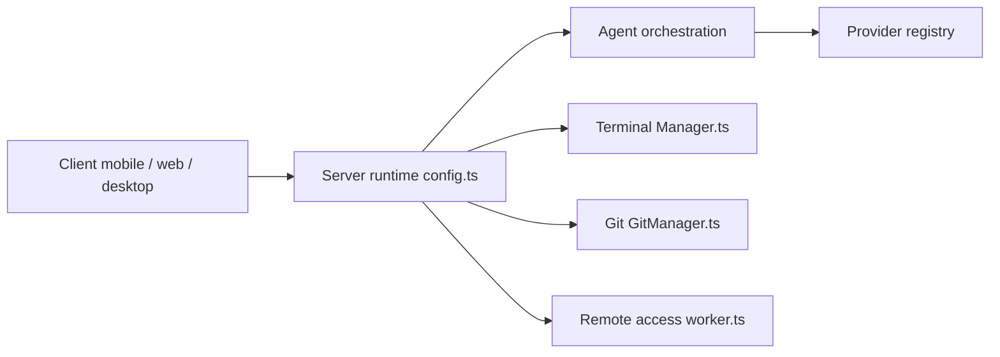

# pingdotgg/t3code

> Web, mobile, and desktop interface for remotely controlling agents that have already been installed on your machine.

## The problem
Code agents (such as Claude Code, Codex, Cursor…) operate within their own terminal or tool. It is not intended to be managed from a phone or another machine.

## What it actually does
A local or remote T3 server coordinates the installed agents (Codex, Claude, Cursor, Grok Build, OpenCode, Antigravity) and exposes their work through a mobile, web, and Electron app. It manages terminals, Git, pull requests, updates, remote access, and an MCP service. It reuses your existing subscriptions: it doesn't sell anything.

## How it is wired


## Trying it
```bash
curl -fsSL https://t3.codes/install.sh | sh
t3
npx t3@latest
brew install --cask t3-code
```

## Cost and gotchas
At least one agent must be installed and authenticated (using `codex login`, `claude auth login`, etc.): the corresponding subscription remains your responsibility. Installation involves using `curl | sh`. The repository contains nearly 3,000 open issues.

## What it is not
Not an agent: he manages those of others. The README states that it is "very, very early" and rejects most contributions. There is no documentation website, only the `docs/` directory.

## Alternatives
The README cites Codex desktop, Conductor, Claude Desktop, and Cursor Glass as inspirations.

## For you
Things to watch out for: Useful if you are deploying multiple agents and want to track them from your phone, but the project is still new and there are reported bugs.
