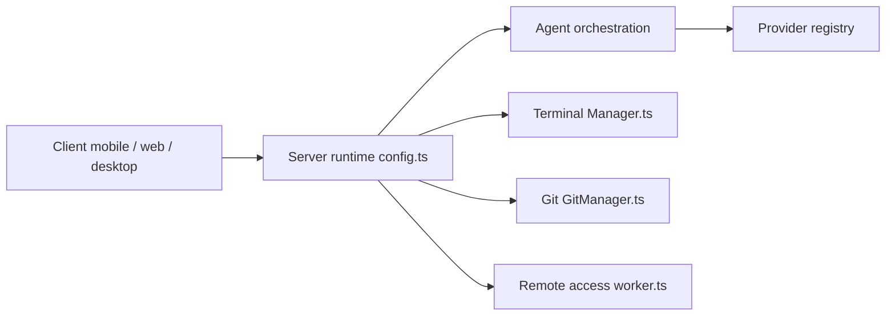

# pingdotgg/t3code

> Interface web, mobile et bureau pour piloter à distance les agents de code déjà installés sur sa machine.

## Le problème
Les agents de code (Claude Code, Codex, Cursor…) vivent chacun dans leur terminal ou leur outil. Les superviser depuis un téléphone ou une autre machine n'est pas prévu.

## Ce que ça fait vraiment
Un serveur T3 local ou distant coordonne les agents installés (Codex, Claude, Cursor, Grok Build, OpenCode, Antigravity) et expose leur travail via une app mobile, web et Electron. Il gère terminal, Git, pull requests, mises à jour, accès distant et un service MCP. Il réutilise tes abonnements existants : il ne vend rien.

## Comment c'est branché


## Essayer
```bash
curl -fsSL https://t3.codes/install.sh | sh
t3
npx t3@latest
brew install --cask t3-code
```

## Coût et pièges
Au moins un agent doit être installé et authentifié (`codex login`, `claude auth login`…) : l'abonnement correspondant reste à ta charge. L'installation passe par un `curl | sh`. Le dépôt compte près de 3 000 issues ouvertes.

## Ce que ce n'est pas
Pas un agent : il pilote ceux des autres. Le README dit être « very very early » et refuse la plupart des contributions. Pas de site de documentation, seulement `docs/`.

## Alternatives
Le README cite comme inspirations l'app Codex desktop, Conductor, Claude Desktop et Cursor Glass.

## Pour toi
À surveiller : utile si tu lances plusieurs agents et veux les suivre depuis le téléphone, mais le projet est jeune et les bugs annoncés.

