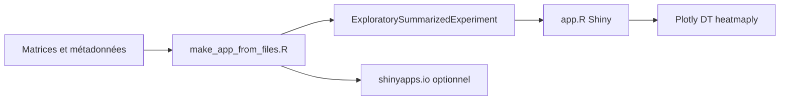

# pinin4fjords/shinyngs

> R package that generates a Shiny app to explore RNA-seq results, designed for bioinformaticians.

## The problem
Presenting gene expression analysis results to non-specialists forces you to cobble together static figures.

## What it actually does
You load matrices, metadata, contrasts and differential results (DESeq2 type) into an extended SummarizedExperiment structure. The package then produces an app with heatmap, PCA, box plots, volcano plot and progressive differential filters. It analyzes nothing itself.

## How it is wired
Simplified diagram based on the fiche, no diagram provided.



## Trying it
```bash
conda create -n shinyngs r-shinyngs
conda activate shinyngs
make_app_from_files.R --assay_files raw.tsv,normalised_counts.tsv --sample_metadata samplesheet.csv --contrast_file contrasts.csv --output_directory app
```

## Cost and gotchas
It is an R package, not Python: it needs R, Bioconductor and ideally Conda. Deploying to shinyapps.io requires an account and two environment variables. Chrome is recommended.

## What it is not
It is not an RNA-seq analysis tool: it visualizes results that are already computed. AGPL-3.0 license, restrictive for a hosted service.

## Alternatives
- START (jminnier/STARTapp): neighboring app, cited as unrelated.
- Degust: another visualizer cited in comparison.

## For you
Watch: useful only if you handle RNA-seq, and the AGPL limits use as a service.
