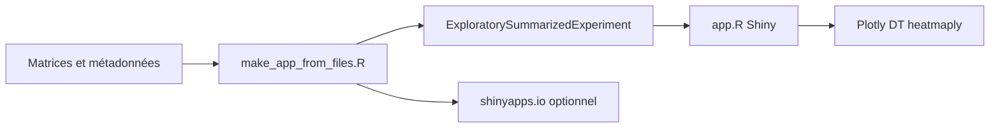

# pinin4fjords/shinyngs

> Package R qui génère une appli Shiny pour explorer des résultats RNA-seq, pensé pour les bioinformaticiens.

## Le problème
Présenter des résultats d'analyse d'expression génique à des non-spécialistes oblige à bricoler des figures statiques.

## Ce que ça fait vraiment
On charge matrices, métadonnées, contrastes et résultats différentiels (type DESeq2) dans une structure SummarizedExperiment étendue. Le package produit alors une appli avec heatmap, PCA, boîtes à moustaches, volcano et filtres différentiels progressifs. Il n'analyse rien lui-même.

## Comment c'est branché
Schéma simplifié d'après la fiche, sans diagramme fourni.



## Essayer
```bash
conda create -n shinyngs r-shinyngs
conda activate shinyngs
make_app_from_files.R --assay_files raw.tsv,normalised_counts.tsv --sample_metadata samplesheet.csv --contrast_file contrasts.csv --output_directory app
```

## Coût et pièges
C'est un package R, pas Python : il faut R, Bioconductor et idéalement Conda. Le déploiement sur shinyapps.io demande un compte et deux variables d'environnement. Chrome est recommandé.

## Ce que ce n'est pas
Ce n'est pas un outil d'analyse RNA-seq : il visualise des résultats déjà calculés. Licence AGPL-3.0, contraignante pour un service hébergé.

## Alternatives
- START (jminnier/STARTapp) : appli voisine, citée comme sans lien.
- Degust : autre visualiseur cité en comparaison.

## Pour toi
Surveiller : utile seulement si tu manipules du RNA-seq, et l'AGPL limite un usage en service.

