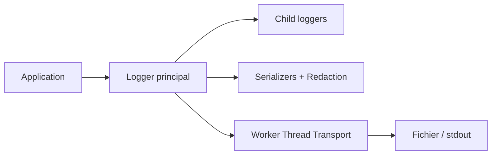

# pinojs/pino

> Very low-overhead JavaScript logger, JSON output, for Node.js applications.

## The problem
A slow or synchronous logger reduces the number of requests per second a service can handle.

## What it actually does
Produces JSON lines (level, timestamp, message, pid, hostname), with child loggers that inherit properties, field redaction and serializers. Heavy processing (shipping, alerts, formatting) is offloaded to "transports" running in a worker thread via `pino.transport`. `pino-pretty` is for development. It also works under Bare and Pear via `pino-bare`.

## How it is wired


## Trying it
```bash
npm install pino
```
```js
const logger = require('pino')()
logger.info('hello world')
const child = logger.child({ a: 'property' })
```

## Cost and gotchas
Free. The README recommends not doing log processing in the main thread.

## What it is not
It is not an observability platform: it emits logs, it neither stores nor analyzes them.

## Alternatives
The README says "over 5x faster than alternatives" without naming any.

## For you
Ignore for a Python data/AI profile; useful only if you write Node.js services.
