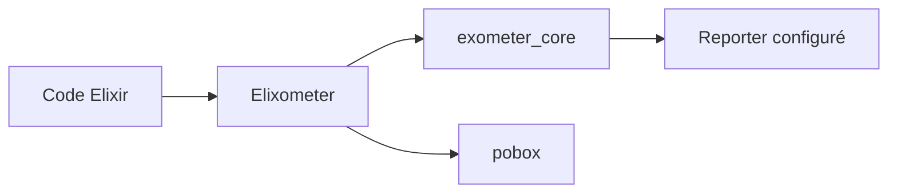

# pinterest/elixometer

> Elixir layer on top of exometer for defining metrics and sending them to the default reporter.

## The problem
In exometer, a metric must be declared before it can be updated, which makes the code heavier.

## What it actually does
Lets you update counters, histograms, gauges, spirals and timers directly, named by dot-separated strings. The `@timed` annotation times a function. A prefix and the environment are added to the names, a formatter can be customized, and `pobox` limits the message queue.

## How it is wired
Simplified diagram based on the sheet, no diagram provided.


## Trying it
```bash
# mix.exs : {:elixometer, "~> 1.5"}
```

## Cost and gotchas
Free. Requires Elixir and mix. The OpenTSDB and Statsd reporters require the full exometer package. Last push in July 2023.

## What it is not
It is not a metrics server: it sends nothing without a configured exometer reporter.

## Alternatives
Not documented in the README.

## For you
Ignore: reserved for the Elixir ecosystem and not updated for over three years, it brings nothing to a Python data / AI / MLOps profile.
