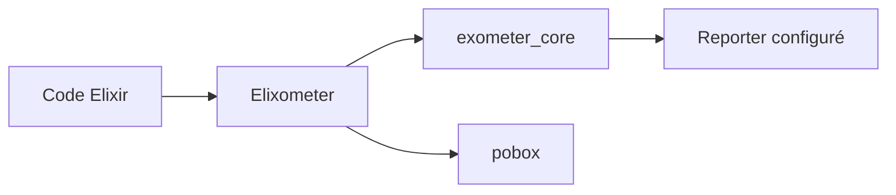

# pinterest/elixometer

> Surcouche Elixir à exometer pour définir des métriques et les envoyer au reporter par défaut.

## Le problème
Dans exometer, il faut déclarer une métrique avant de la mettre à jour, ce qui alourdit le code.

## Ce que ça fait vraiment
Permet de mettre à jour directement compteurs, histogrammes, jauges, spirales et minuteurs, nommés par chaînes séparées par des points. L'annotation `@timed` chronomètre une fonction. Un préfixe et l'environnement sont ajoutés aux noms, un formateur est personnalisable, et `pobox` limite la file de messages.

## Comment c'est branché
Schéma simplifié d'après la fiche, sans diagramme fourni.


## Essayer
```bash
# mix.exs : {:elixometer, "~> 1.5"}
```

## Coût et pièges
Gratuit. Il faut Elixir et mix. Les reporters OpenTSDB et Statsd exigent le paquet exometer complet. Dernier push en juillet 2023.

## Ce que ce n'est pas
Ce n'est pas un serveur de métriques : il n'envoie rien sans reporter exometer configuré.

## Alternatives
Non documenté dans le README.

## Pour toi
À ignorer : réservé à l'écosystème Elixir et sans mise à jour depuis plus de trois ans, il n'apporte rien à un profil data / IA / MLOps en Python.

