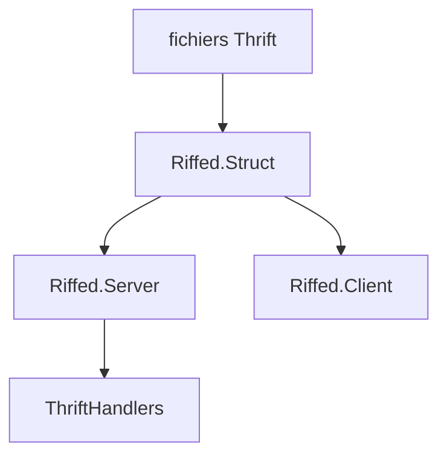

# pinterest/riffed

> Elixir library that makes Thrift pleasant: generated structs, clients and servers.

## The problem
Erlang's Thrift implementation forces records and tuples, loses enumerations and requires repetitive handling code.

## What it actually does
Three modules: `Riffed.Struct` converts Thrift types into Elixir structs (`to_elixir`, `to_erlang`), `Riffed.Server` generates the server and calls your handlers with structs, `Riffed.Client` generates the client. Enumerations must be redefined with `defenum`, `enumerize_struct` and `enumerize_function`.

## How it is wired
Simplified diagram based on the sheet, no diagram provided.


## Trying it
```bash
mix docs
```

## Cost and gotchas
Archived repository, last push in 2020. Thrift enumerations must be redeclared by hand.

## What it is not
Not a Thrift generator: it relies on the Erlang modules generated by Thrift.

## Alternatives
No alternative named in the README.

## For you
Ignore: archived since 2020 and limited to Elixir/Thrift.
