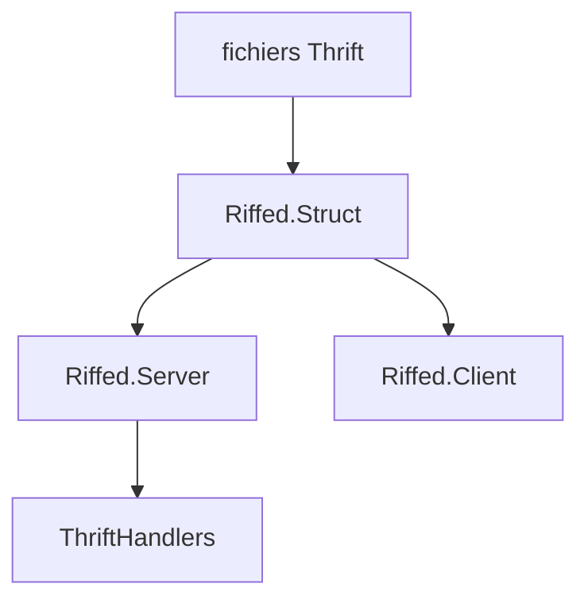

# pinterest/riffed

> Bibliothèque Elixir qui rend Thrift agréable : structs, clients et serveurs générés.

## Le problème
L'implémentation Thrift d'Erlang impose des records, des tuples, perd les énumérations et demande du code de gestion répétitif.

## Ce que ça fait vraiment
Trois modules : `Riffed.Struct` convertit les types Thrift en structs Elixir (`to_elixir`, `to_erlang`), `Riffed.Server` génère le serveur et appelle tes handlers avec des structs, `Riffed.Client` génère le client. Les énumérations sont à redéfinir avec `defenum`, `enumerize_struct` et `enumerize_function`.

## Comment c'est branché
Schéma simplifié d'après la fiche, sans diagramme fourni.


## Essayer
```bash
mix docs
```

## Coût et pièges
Dépôt archivé, dernier push en 2020. Les énumérations Thrift doivent être redéclarées à la main.

## Ce que ce n'est pas
Pas un générateur Thrift : il s'appuie sur les modules Erlang générés par Thrift.

## Alternatives
Aucune alternative nommée dans le README.

## Pour toi
Ignorer : archivé depuis 2020 et limité à Elixir/Thrift.

