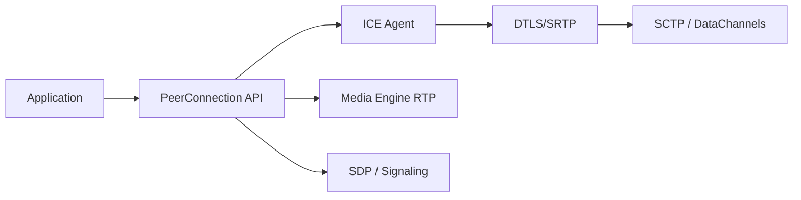

# pion/webrtc

> Pure Go WebRTC implementation, no Cgo, for developers of real-time audio, video and data streams.

## The problem
WebRTC is dominated by C++ stacks that are hard to embed in a Go server or device.

## What it is not... (see below)
The README presents the PeerConnection API (data channels, audio/video, renegotiation), a full ICE agent (STUN, TURN, ICE restart, trickle), DTLS/SRTP, Opus/H264/VP8/VP9 packetizers, simulcast, SVC, NACK and bandwidth estimation. Pure Go, cross-platform (including WASM), no Cgo (except `getUserMedia`).

## What it actually does
A library where the application drives a PeerConnection; underneath sit ICE, DTLS, SCTP (data channels), an RTP/RTCP media engine, SDP/signaling and interceptors, tunable through `SettingEngine`. Examples are provided in neighboring repositories.

## How it is wired


## Trying it
```bash
export GO111MODULE=on
```
Import with an explicit `/v4`. No other command in the README (examples are in a separate repository).

## Cost and gotchas
Free. Go modules are mandatory. A v4 has been released: projects on v3 must migrate. No signaling server is provided.

## What it is not
It is not a ready-to-use video conferencing server: it is a building block. It is not a browser client.

## Alternatives
No alternative is named in the README.

## For you
Worth watching: a solid building block if you stream data or feeds to models from Go; outside Go, of no direct interest.
