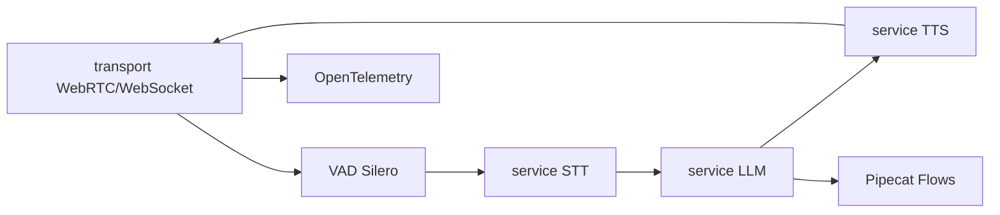

# pipecat-ai/pipecat

> Python framework for real-time voice and multimodal agents.

## The problem
A natural voice conversation requires chaining VAD, transcription, LLM,
synthesis and WebRTC transport with sustained latency — each component having its own API.

## What it actually does
Assembles composable pipelines where each pipeline is an agent: you compose by
handoff, parallel fan-out, side-car workers on a shared bus, locally or
distributed across processes and machines. A very broad catalog of integrations:
speech-to-text (AssemblyAI, Deepgram, Whisper, Gladia, Speechmatics…), LLM
(Anthropic, Gemini, OpenAI, Mistral, Ollama, Groq…), text-to-speech (Cartesia,
ElevenLabs, Piper, Kokoro…), speech-to-speech (OpenAI Realtime, Gemini Multimodal
Live, AWS Nova Sonic), transports (Daily, LiveKit, SmallWebRTC, WebSocket, WhatsApp),
telecom serializers (Twilio, Telnyx, Plivo, Genesys), video (HeyGen, Tavus),
memory (mem0), audio processing (Silero VAD, Krisp, RNNoise), OpenTelemetry
metrics and Sentry. Pipecat Flows handles structured conversations.

## How it is wired


## Trying it
```bash
uv tool install "pipecat-ai[cli]"
pipecat init quickstart
claude plugin marketplace add pipecat-ai/skills
```

## Cost and gotchas
The framework is free, the bill comes from the providers: STT, LLM and TTS are
billed per minute or per token, and a voice agent consumes continuously. A managed
WebRTC transport (Daily, LiveKit) adds its own cost. The CLI is also used
to deploy to Pipecat Cloud — a commercial offering from the same vendor.

## What it is not
Not a turnkey voice agent: a framework to wire up, and the choice of services
is entirely yours. The README is truncated before the end. The companion tools (Whisker,
Tail, Pipecat UI) are separate repositories.

## Alternatives
- Pipecat Flows: built in, for predefined conversational paths.
- No external alternative is named in the README.

## For you
The Python reference for a voice agent; worth watching if a client project
calls for real-time voice.
