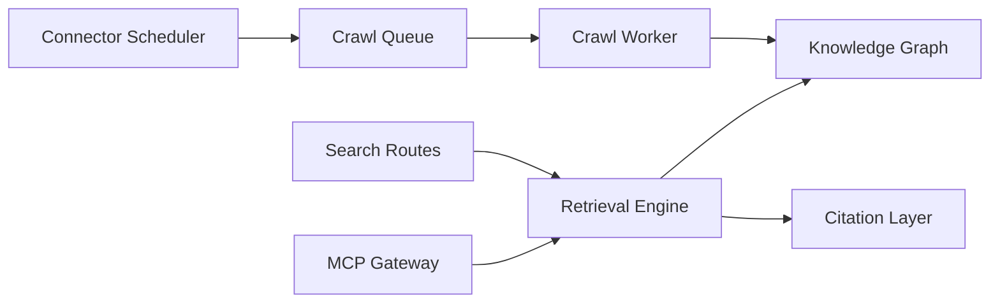

# pipeshub-ai/pipeshub-ai

> Self-hosted enterprise search platform with citations, respecting the access rights of the sources.

## The problem
An LLM's answers over internal documents (Slack, Drive, GitHub, Microsoft 365, Notion) must respect who is allowed to see what.

## What it actually does
Connectors (50+ according to the README) sync the sources; documents are parsed then stored in a knowledge graph (Neo4j or ArangoDB), Qdrant and MongoDB. At query time, filtering is done on the source's permissions, and an LLM answers with block-level citations. The stack: Next.js application, Node.js API, Python services; an MCP server, SDKs (Python, TypeScript, Go) and a no-code agent builder are offered.

## How it is wired


## Trying it
```bash
curl -fsSL https://get.pipeshub.com/install | bash
git clone https://github.com/pipeshub-ai/pipeshub-ai.git
cd pipeshub-ai
./install.sh
```

## Cost and gotchas
Docker Compose v2; the installer checks RAM and disk. You need an LLM and an embedding model (provider of your choice or Ollama). Cloud deployments require HTTPS. The README advises reading the script before running it.

## What it is not
Not a managed service: the cloud offering is "coming soon". Audio and video are stored but not indexed. Several internal links in the architecture are inferred, not verified in the code.

## Alternatives
No alternative is cited in the README.

## For you
Worth watching: relevant if you need enterprise RAG with permissions, but a heavy stack (graph, vectors, MongoDB, Redis) and 158 open issues.
