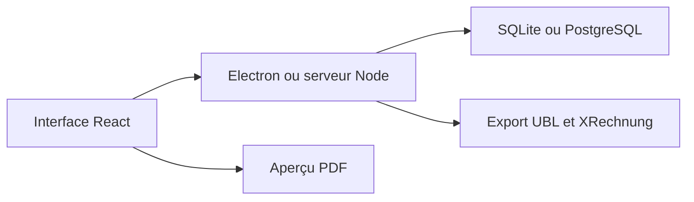

# piratuks/invoice-builder

> Offline invoicing and quoting app for freelancers and small businesses, with a Docker mode.

## The problem
Online invoicing tools require an account, a subscription and hosting your data with a third party.

## What it actually does
Electron and React application on SQLite, with invoices and quotes, PDF preview, layout editor, XLSX import and export, full backup. E-invoice export in UBL 2.1 / Peppol BIS and XRechnung. Self-hosted web mode with SQLite or PostgreSQL.

## How it is wired
Simplified diagram based on the sheet, no diagram provided.



## Trying it
```bash
git clone https://github.com/piratuks/invoice-builder.git
cd invoice-builder
docker compose pull
docker compose up -d
```
Then open http://localhost:3001.

## Cost and gotchas
Free, MIT. Backup required before 3.0.2 (migrations up to 2.10.0). The public demo runs on a free Render plan, with data potentially visible to everyone.

## What it is not
Not a hosted service: your data stays with you. No account or cloud, but no tax compliance guarantee is documented.

## Alternatives
No alternative named in the README.

## For you
Ignore: invoicing software unrelated to a data or MLOps profile, useful only for freelance activity.
