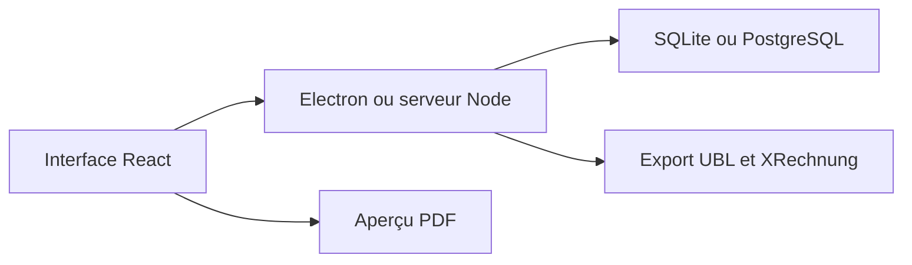

# piratuks/invoice-builder

> Application de facturation et de devis hors ligne pour indépendants et petites structures, avec mode Docker.

## Le problème
Les outils de facturation en ligne imposent compte, abonnement et hébergement de tes données chez un tiers.

## Ce que ça fait vraiment
Application Electron et React sur SQLite, avec factures et devis, aperçu PDF, éditeur de mise en page, import et export XLSX, sauvegarde complète. Export e-facture UBL 2.1 / Peppol BIS et XRechnung. Mode web auto-hébergé avec SQLite ou PostgreSQL.

## Comment c'est branché
Schéma simplifié d'après la fiche, sans diagramme fourni.



## Essayer
```bash
git clone https://github.com/piratuks/invoice-builder.git
cd invoice-builder
docker compose pull
docker compose up -d
```
Puis ouvrir http://localhost:3001.

## Coût et pièges
Gratuit, MIT. Sauvegarde obligatoire avant la 3.0.2 (migrations jusqu'à la 2.10.0). La démo publique est sur un plan gratuit de Render, avec des données potentiellement visibles de tous.

## Ce que ce n'est pas
Pas un service hébergé : tes données restent chez toi. Pas de compte ni de cloud, mais aucune garantie de conformité fiscale n'est documentée.

## Alternatives
Aucune alternative nommée dans le README.

## Pour toi
À ignorer : logiciel de facturation sans lien avec un profil data ou MLOps, utile seulement pour une activité indépendante.

