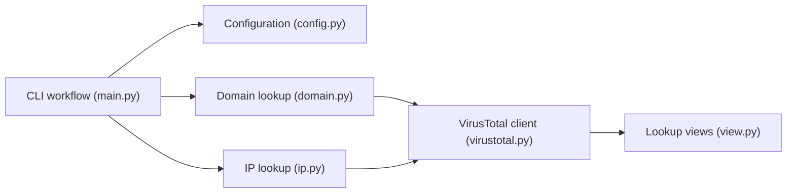

# pirxthepilot/wtfis

> Command-line tool that aggregates OSINT services to provide information on a domain, hostname or IP.

## The problem
IP or domain reputation lookups are scattered across services with hard-to-read interfaces and tight quotas.

## What it actually does
- Queries VirusTotal (main source), plus AbuseIPDB, Greynoise, IP2Location, IP2Whois, IPinfo, IPWhois, Shodan, URLhaus.
- Displays readable panels in the terminal; accepts "defanged" inputs.
- Limits calls to stay within free quotas; each service is optional.

## How it is wired


## Trying it
```bash
pip install wtfis
export VT_API_KEY=...
wtfis FQDN_OR_DOMAIN_OR_IP
wtfis -A example.com
```

## Cost and gotchas
Free with community accounts; one key per service, low quotas (Greynoise: 50 requests per week in 2023). The `~/.env.wtfis` file must be protected with `chmod 400`.

## What it is not
Not an active scanner: passive requests only, against third-party databases.

## Alternatives
No alternative named in the README.

## For you
Worth watching: useful if you do incident response or IoC enrichment, marginal for a data/AI profile.
