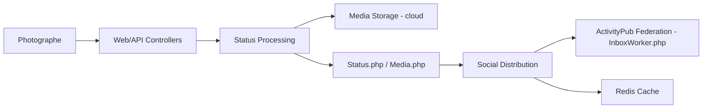

# pixelfed/pixelfed

> Federated (ActivityPub) photo-sharing platform, self-hosted, for instance administrators.

## The problem
Centralized photo networks impose their algorithm and rules. Without a self-hosted alternative, you have no control over your data or your audience.

## What it actually does
Laravel application: a user posts a photo, the media is validated and processed (image and video optimization), the Status/Media records are written, then the post is distributed to followers and fediverse peers. The code also shows direct messages, groups, stories, lives, imports, moderation and account migration. The media, feed and federation steps are asynchronous (jobs).

## How it is wired


## Trying it
The README points to external documentation: since September 2026, Docker Compose is recommended. No command is given in the README itself.

```bash
# non documenté dans le README : voir le site de documentation Pixelfed
```

## Cost and gotchas
Self-hosting: server, Redis, possibly object (cloud) storage, domain name. An "unofficial cloud providers" section is listed but empty in the excerpt.

## What it is not
Not a ready-to-use service: you have to operate an instance. AI-generated contributions are refused, which matters if you plan to propose assisted patches.

## Alternatives
No alternative named in the README.

## For you
Outside the data/AI/MLOps scope: worth watching only if you want to run a fediverse instance, otherwise of no direct interest for your profile.
