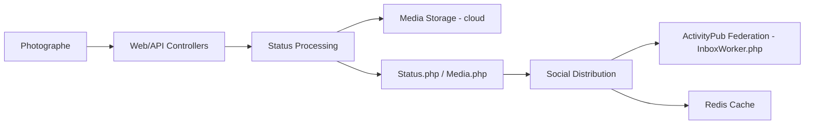

# pixelfed/pixelfed

> Plateforme de partage de photos fédérée (ActivityPub), à héberger soi-même, pour administrateurs d'instances.

## Le problème
Les réseaux photo centralisés imposent leur algorithme et leurs règles. Sans alternative auto-hébergée, pas de contrôle sur ses données ni sur sa audience.

## Ce que ça fait vraiment
Application Laravel : un utilisateur publie une photo, le média est validé et traité (optimisation image, vidéo), les enregistrements Status/Media sont écrits, puis la publication est distribuée aux abonnés et aux pairs du fediverse. Le code montre aussi messages directs, groupes, stories, lives, imports, modération et migration de compte. Les étapes média, flux et fédération sont asynchrones (jobs).

## Comment c'est branché


## Essayer
Le README renvoie à la documentation externe : depuis septembre 2026, Docker Compose est recommandé. Aucune commande n'est donnée dans le README lui-même.

```bash
# non documenté dans le README : voir le site de documentation Pixelfed
```

## Coût et pièges
Auto-hébergement : serveur, Redis, stockage objet (cloud) éventuel, nom de domaine. Section « fournisseurs cloud non officiels » listée mais vide dans l'extrait.

## Ce que ce n'est pas
Pas un service prêt à l'emploi : il faut opérer une instance. Les contributions générées par IA sont refusées, ce qui compte si tu comptes proposer des correctifs assistés.

## Alternatives
Aucune alternative nommée dans le README.

## Pour toi
Hors périmètre data/IA/MLOps : à surveiller seulement si tu veux opérer une instance fediverse, sinon sans intérêt direct pour ton profil.

