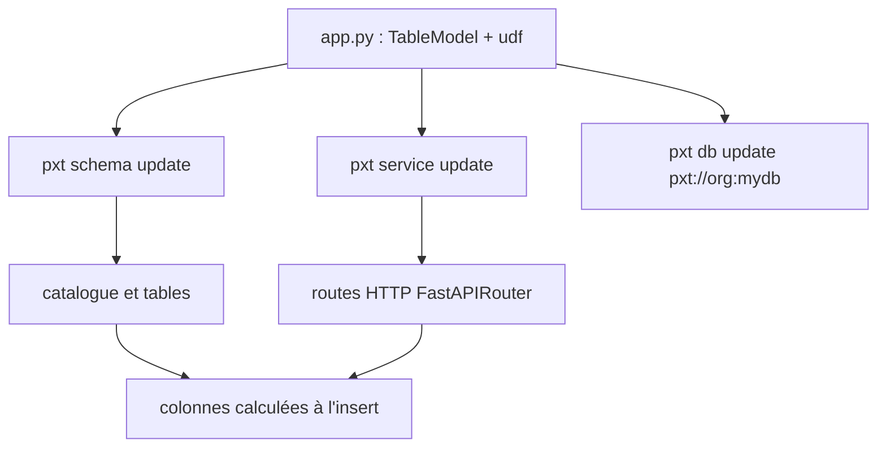

# pixeltable/pixeltable

> Multimodal database where transformations, indexes and HTTP routes are declared in a single Python file.

## The problem
A multimodal application is usually spread across four systems: object storage, vector database, orchestrator, endpoint code.
The code that copies data between them has to be written, maintained, and reviewed in four separate diffs.

## What it actually does
Images, videos, audio and documents live in tables; a transformation is a computed column, an index is a declaration.
Inserting a row triggers everything downstream. An HTTP route is declared with `FastAPIRouter` in the same file.
`pxt schema update` creates the catalog and tables without starting HTTP; `pxt service update` starts HTTP without creating tables.
The same `app.py` runs locally or on Pixeltable Cloud, targeted by URI `pxt://org:mydb`.

## How it is wired


## Trying it
```bash
pip install 'pixeltable[serve]'
pxt init
pxt service example --out app.py
pxt schema update app.py my_app
pxt service update app.py my_app
```

## Cost and gotchas
The port is assigned dynamically: read it back via `pxt service list --json` rather than hard-coding it.
The `/ask` route of the demo app requires `ANTHROPIC_API_KEY`; Pixeltable Cloud is in limited beta on request by email.

## What it is not
Not a simple ORM: the engine runs transformations at insert time, which moves the compute cost into the database.
Not a frozen product: the README warns that the installed agent skill may be outdated (`pxt serve` removed, `create_table` moved).
Notebooks and tests still use `pxt.create_table()`, the application does not — two conventions coexist.

## Alternatives
No alternative named in the README.

## For you
The RAG / media pipeline use case in a single file is worth a local try; the Cloud is not, as long as it is in closed beta.
