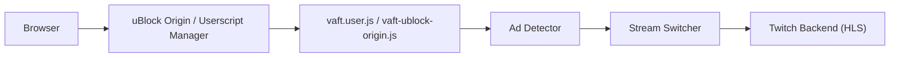

# pixeltris/TwitchAdSolutions

> Userscripts and uBlock Origin rules to block Twitch ads, archived repository.

## The problem
Ads interrupt playback of Twitch streams.

## What it actually does
Two strategies: `vaft` and `video-swap-new`. They try to obtain an ad-free stream, otherwise strip the ad segments (playback paused until the clean stream arrives). Delivered as a userscript or as a uBlock Origin resource. The README first recommends proxies such as TTV LOL PRO.

## How it is wired

## Trying it
Add `twitch.tv##+js(twitch-videoad)` to uBlock Origin's "My filters", then set `userResourcesLocation` to the script's URL.

## Cost and gotchas
Free. The repository has been archived since 2026-03-05: no more fixes while Twitch changes its streams. The README warns that the scripts may stop working.

## What it is not
Not maintained, and not the most reliable method according to the README itself (proxies are more reliable).

## Alternatives
TTV LOL PRO, Twitch Turbo, Alternate Player for Twitch.tv, Purple AdBlock.

## For you
Ignore: archived repository, outside the data/AI scope, and the author himself advises against it in favor of other solutions.
