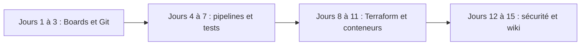

# piyushsachdeva/AzureDevOps-Zero-to-Hero

> Free fifteen-day video course on Azure DevOps, with daily notes, for DevOps beginners.

## The problem
Mastering Azure DevOps (boards, repos, pipelines, tests, artifacts) requires a structured path, with concrete projects.

## What it actually does
A day-by-day course plan: DevOps concepts, Boards, Git, build and release pipelines, Test Plans, Artifacts, Terraform, self-hosted agents, containers, Kubernetes, security, Functions and wiki. Each day has a notes folder and a YouTube video. A bonus covers interview questions.

## How it is wired
Simplified diagram based on the sheet, no diagram provided.

## Trying it
No command documented in the README: the course is followed through the `DayN` folders and the YouTube playlist.

## Cost and gotchas
Free course. The real demos require an Azure DevOps account and Azure resources, potentially billed. Last push on 2025-09-18.

## What it is not
Not a software tool: it is training material. No license is declared, and nothing guarantees it will be kept up to date as Azure DevOps evolves.

## Alternatives
No alternative named in the README.

## For you
Worth watching: a good foundation for the CI/CD side of an MLOps job on Azure, but the content may be dated and has no clear license.
