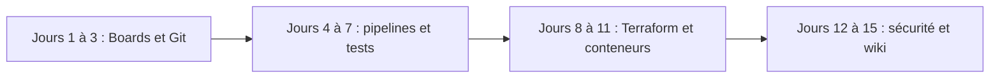

# piyushsachdeva/AzureDevOps-Zero-to-Hero

> Cours vidéo gratuit sur Azure DevOps en quinze jours, avec notes par jour, pour DevOps débutants.

## Le problème
Maîtriser Azure DevOps (boards, dépôts, pipelines, tests, artefacts) demande un parcours structuré, avec des projets concrets.

## Ce que ça fait vraiment
Un plan de cours jour par jour : concepts DevOps, Boards, Git, pipelines de build et de release, Test Plans, Artifacts, Terraform, agents auto-hébergés, conteneurs, Kubernetes, sécurité, Functions et wiki. Chaque jour a un dossier de notes et une vidéo YouTube. Un bonus couvre les questions d'entretien.

## Comment c'est branché
Schéma simplifié d'après la fiche, sans diagramme fourni.

## Essayer
Aucune commande documentée dans le README : le cours se suit via les dossiers `DayN` et la playlist YouTube.

## Coût et pièges
Cours gratuit. Les démos réelles demandent un compte Azure DevOps et des ressources Azure, potentiellement facturées. Dernier push le 2025-09-18.

## Ce que ce n'est pas
Pas un outil logiciel : c'est un support de formation. Aucune licence n'est déclarée, et rien ne garantit la mise à jour face à l'évolution d'Azure DevOps.

## Alternatives
Aucune alternative nommée dans le README.

## Pour toi
À surveiller : bonne base pour le versant CI/CD d'un poste MLOps sous Azure, mais contenu possiblement daté et sans licence claire.

