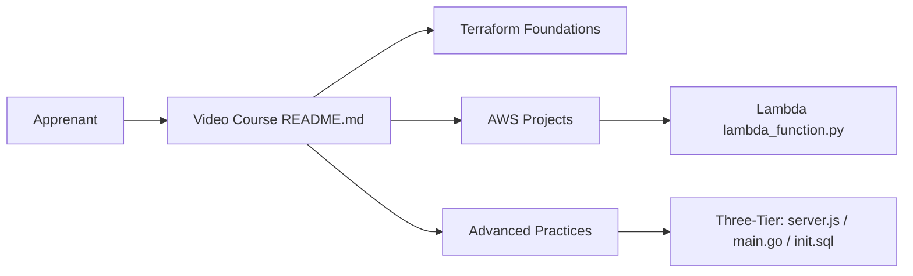

# piyushsachdeva/Terraform-Full-Course-Aws

> Terraform video course on AWS, with code examples per lesson, for beginner and intermediate DevOps.

## The problem
Learning infrastructure as code needs a progressive path with code that can actually be deployed, not just theory.

## What it actually does
A repo that accompanies 30 videos in three modules: basics (providers, state, variables, loops, functions), AWS projects (S3/CloudFront, VPC, IAM, Lambda, EKS, RDS, monitoring, high availability) and advanced (import, Terraform Cloud, CI/CD, 3-tier, GitOps with ArgoCD). Each lesson has a code sample and exercises (`task.md`). Example applications: Go frontend/API/"goals" database, image-processing Lambda.

## How it is wired

## Trying it
No command documented. The README advises: follow the videos in order, do the `task.md` exercises, build the projects.

## Cost and gotchas
The code is free but creates real AWS resources (EKS, RDS, NAT Gateway…) billed to you. AWS account required. 748 open issues.

## What it is not
Not a reusable Terraform module nor a tool: it is course material. The quality of the examples was not checked lesson by lesson.

## Alternatives
No alternative cited in the README.

## For you
Worth watching: good material to build IaC/MLOps skills (EKS, monitoring, GitOps), to be used with a capped AWS budget.
