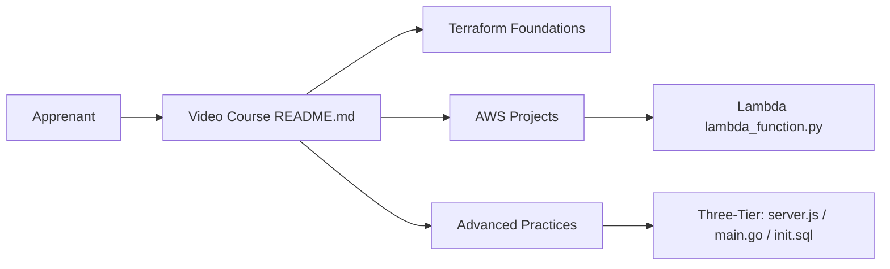

# piyushsachdeva/Terraform-Full-Course-Aws

> Cours vidéo Terraform sur AWS, avec exemples de code par leçon, pour débutants et intermédiaires DevOps.

## Le problème
Apprendre l'infrastructure as code demande un parcours progressif avec du code réellement déployable, pas seulement de la théorie.

## Ce que ça fait vraiment
Un dépôt qui accompagne 30 vidéos en trois modules : bases (providers, state, variables, boucles, fonctions), projets AWS (S3/CloudFront, VPC, IAM, Lambda, EKS, RDS, monitoring, haute dispo) et avancé (import, Terraform Cloud, CI/CD, 3-tiers, GitOps avec ArgoCD). Chaque leçon a un échantillon de code et des exercices (`task.md`). Exemples d'application : frontend/API Go/base « goals », Lambda de traitement d'image.

## Comment c'est branché

## Essayer
Aucune commande documentée. Le README conseille : suivre les vidéos dans l'ordre, faire les exercices de `task.md`, réaliser les projets.

## Coût et pièges
Le code est gratuit mais crée de vraies ressources AWS (EKS, RDS, NAT Gateway…) facturées à ta charge. Compte AWS nécessaire. 748 issues ouvertes.

## Ce que ce n'est pas
Pas un module Terraform réutilisable ni un outil : c'est un support de cours. La qualité des exemples n'a pas été vérifiée lesson par lesson.

## Alternatives
Aucune alternative citée dans le README.

## Pour toi
À surveiller : bon support pour monter en compétence IaC/MLOps (EKS, monitoring, GitOps), à utiliser avec un budget AWS plafonné.

