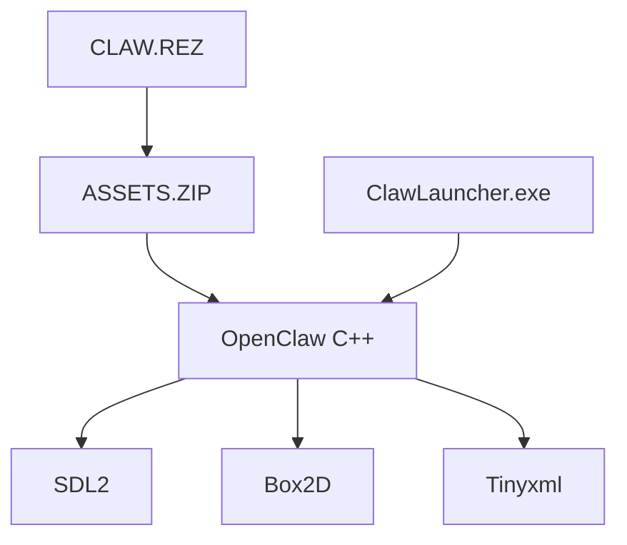

# pjasicek/OpenClaw

> Cross-platform C++ reimplementation of the platform game Captain Claw (1997), to replay it with the original assets.

## The problem
The 1997 game no longer runs natively on current systems. It is not available on Linux, Android or the web.

## What it actually does
C++ code written from scratch, with SDL2 for display and sound, Box2D for physics and Tinyxml for data. It reads the original game's `CLAW.REZ` archive. Targets: Windows, Linux, macOS, Android and WebAssembly. A Claw Launcher sets up the configuration.

## How it is wired
Simplified diagram based on the note, no diagram provided.



## Trying it
```bash
git clone https://github.com/pjasicek/OpenClaw.git
sudo apt install libsdl2-dev libsdl2-image-dev libsdl2-mixer-dev libsdl2-ttf-dev libsdl2-gfx-dev
mkdir build
cd build
cmake ..
make
```

## Cost and gotchas
Free, but you must own the `CLAW.REZ` file from the original game. The WebAssembly version disables MIDI music. Last push in 2022.

## What it is not
It is not a complete standalone game: the assets are not provided. The README screenshots are still to be done.

## Alternatives
No alternative named in the README.

## For you
Ignore: a retro game unrelated to data or AI, and with no activity since 2022.
