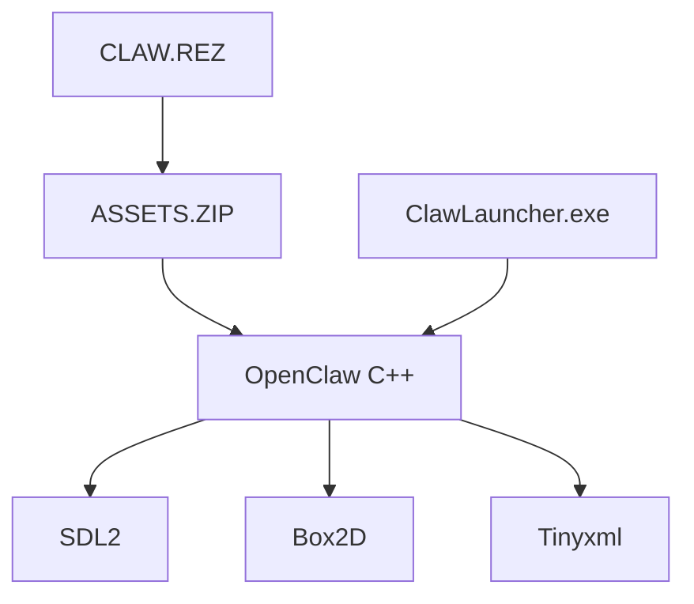

# pjasicek/OpenClaw

> Réimplémentation C++ multiplateforme du jeu de plateforme Captain Claw (1997), pour rejouer avec les ressources d'origine.

## Le problème
Le jeu de 1997 ne tourne plus nativement sur les systèmes actuels. Il n'est pas disponible sur Linux, Android ou le web.

## Ce que ça fait vraiment
Code C++ écrit de zéro, avec SDL2 pour l'affichage et le son, Box2D pour la physique et Tinyxml pour les données. Il lit l'archive `CLAW.REZ` du jeu original. Cibles : Windows, Linux, macOS, Android et WebAssembly. Un lanceur Claw Launcher règle la configuration.

## Comment c'est branché
Schéma simplifié d'après la fiche, sans diagramme fourni.



## Essayer
```bash
git clone https://github.com/pjasicek/OpenClaw.git
sudo apt install libsdl2-dev libsdl2-image-dev libsdl2-mixer-dev libsdl2-ttf-dev libsdl2-gfx-dev
mkdir build
cd build
cmake ..
make
```

## Coût et pièges
Gratuit, mais il faut posséder le fichier `CLAW.REZ` du jeu d'origine. La version WebAssembly désactive la musique MIDI. Dernier push en 2022.

## Ce que ce n'est pas
Ce n'est pas un jeu complet autonome : les ressources ne sont pas fournies. Les captures d'écran du README restent à faire.

## Alternatives
Aucune alternative nommée dans le README.

## Pour toi
À ignorer : un jeu rétro sans rapport avec la data ou l'IA, et sans activité depuis 2022.

