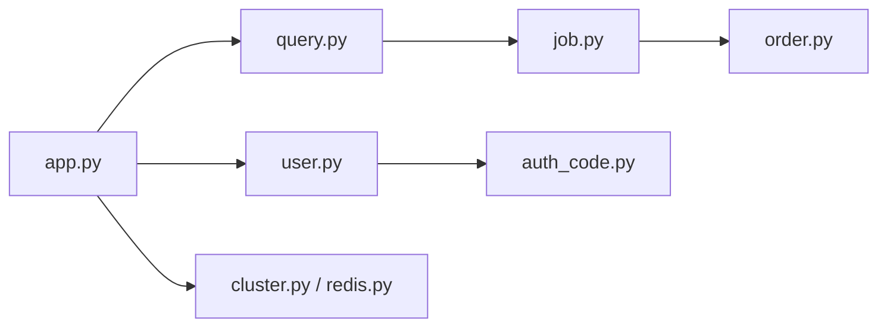

# pjialin/py12306

> Python assistant that watches for and books train tickets on the Chinese 12306 site.

## The problem
Chinese train tickets sell out fast; monitoring availability across several dates and accounts by hand is tedious.

## What it actually does
Queries seats by dates, routes and stations, maintains account sessions, solves the captcha (only the `free` mode remains; the paid "ruoshi" solution is discontinued), places the order, and notifies (email, voice, Telegram, DingTalk, ServerChan). Distributed mode via Redis, optional web interface.

## How it is wired


## Trying it
```bash
git clone https://github.com/pjialin/py12306
pip install -r requirements.txt
cp env.py.example env.py
python main.py -t
python main.py
```

## Cost and gotchas
A 12306 account is required. Voice notifications go through a paid Aliyun service. README in Chinese, Python 3.6+ "other versions untested". Risk of IP blocking from a cloud host.

## What it is not
Not a generic product. It depends on 12306's unofficial API and a third-party captcha service: it may break without warning.

## Alternatives
No alternative named in the README.

## For you
Skip it: unrelated to a data/AI/MLOps profile, and fragile since it is grafted onto a third-party site.
