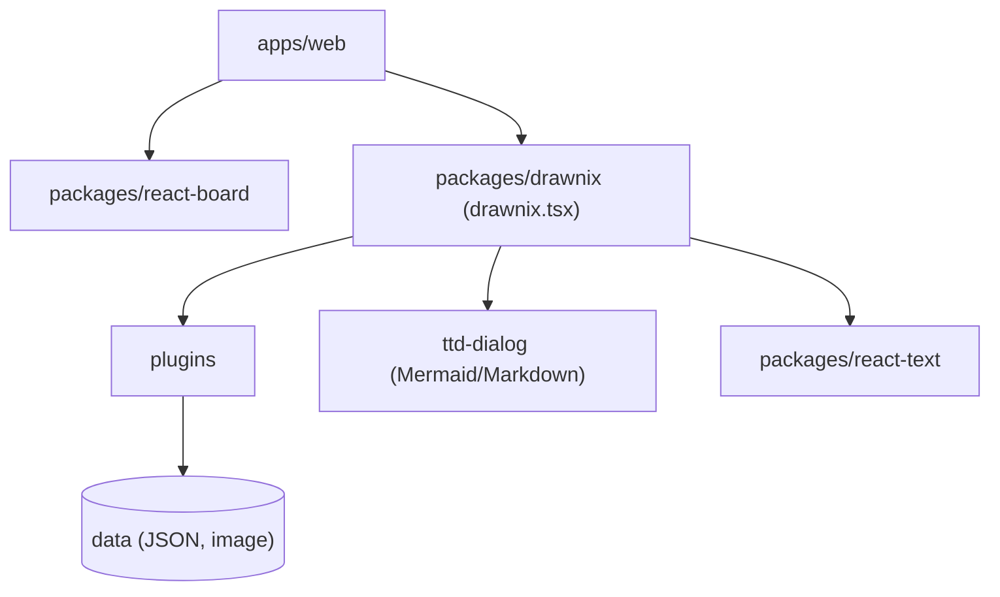

# plait-board/drawnix

> Open-source all-in-one whiteboard: mind maps, diagrams and freehand drawing, in the browser.

## The problem
There is no free whiteboard tool combining mind map, flowchart and drawing without going through a closed SaaS.

## What it actually does
Infinite canvas with mind maps, diagrams, pencil, images, themes and mobile support. Converts Mermaid syntax into a diagram and Markdown into a mind map. PNG export and `.drawnix` JSON, autosave in the browser cache. Plugin architecture on the Plait framework, React interface, text via Slate. README in Chinese.

## How it is wired


## Trying it
```bash
npm install
npm run start
docker pull pubuzhixing/drawnix:latest
```

## Cost and gotchas
Free. Saved in the browser cache: export to JSON regularly. The README describes the drawnix.com site as a minimal application.

## What it is not
Not a real-time collaboration tool: the README mentions none. Diagrams are not versioned outside of export.

## Alternatives
No alternative named in the README.

## For you
Worth watching: handy for sketching ML architecture diagrams, and Mermaid imports directly.
