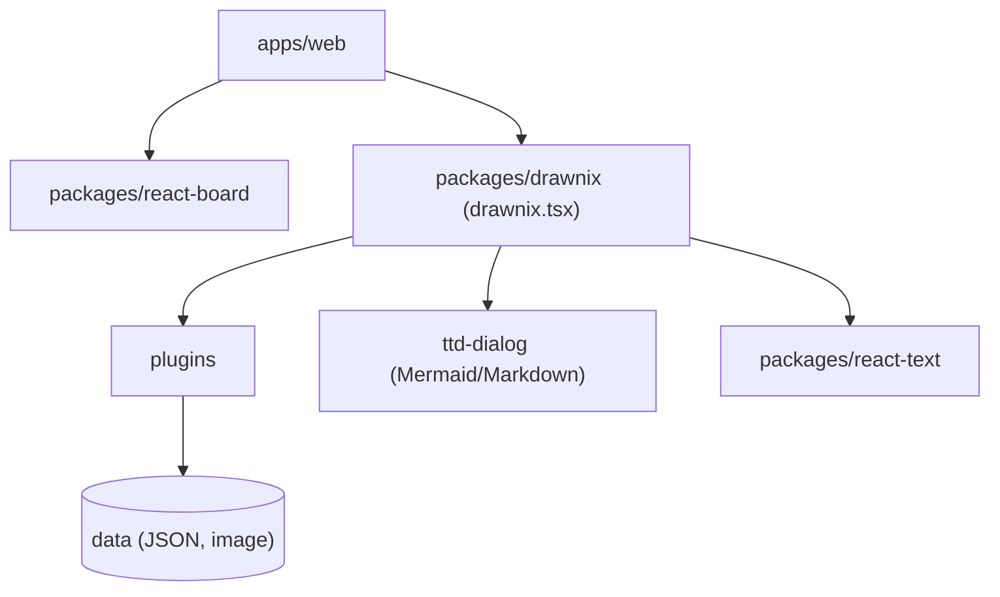

# plait-board/drawnix

> Tableau blanc open source tout-en-un : cartes mentales, diagrammes et dessin libre, dans le navigateur.

## Le problème
Il manque un outil de tableau blanc libre combinant carte mentale, flowchart et dessin sans passer par un SaaS fermé.

## Ce que ça fait vraiment
Canevas infini avec cartes mentales, diagrammes, crayon, images, thèmes et mobile. Convertit une syntaxe Mermaid en diagramme et du Markdown en carte mentale. Export PNG et JSON `.drawnix`, sauvegarde automatique dans le cache du navigateur. Architecture à plugins sur le framework Plait, interface React, texte via Slate. README en chinois.

## Comment c'est branché


## Essayer
```bash
npm install
npm run start
docker pull pubuzhixing/drawnix:latest
```

## Coût et pièges
Gratuit. Sauvegarde dans le cache du navigateur : exporte régulièrement en JSON. Le README décrit le site drawnix.com comme application minimale.

## Ce que ce n'est pas
Pas un outil de collaboration temps réel : le README n'en mentionne aucune. Les diagrammes ne sont pas versionnés hors export.

## Alternatives
Aucune alternative nommée dans le README.

## Pour toi
À surveiller : pratique pour esquisser des schémas d'architecture ML, et Mermaid s'importe directement.

