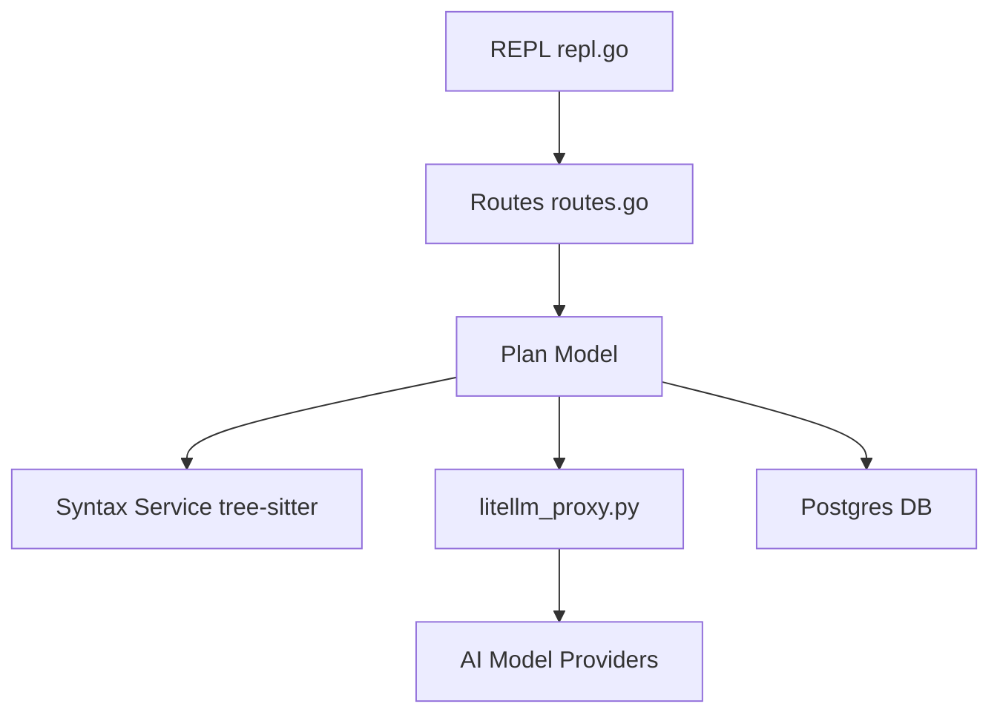

# plandex-ai/plandex

> Terminal coding agent for big multi-file tasks, with a diff sandbox.

## The problem
Coding assistants run out of steam on large projects and leave scattered changes that are hard to review and undo.

## What it actually does
It plans then executes tasks across dozens of files, with up to 2M tokens of context and tree-sitter project maps.
Changes stay in a sandbox of cumulative diffs until approved. Each plan is versioned, with branches.
It automatically debugs commands, integrates with Git and combines several model providers.
The architecture separates a Go CLI and a server with Postgres.

## How it is wired


## Trying it
```bash
curl -sL https://plandex.ai/install.sh | bash
export OPENROUTER_API_KEY=...
plandex
pdx
```

## Cost and gotchas
Keys are at your expense (OpenRouter, or a Claude Pro/Max subscription). Plandex Cloud has been shutting down since 2025-10-03: only self-hosting via Docker remains.

## What it is not
It does not run on Windows outside WSL. No push since 2025-10-03, which raises doubts about its longevity.

## Alternatives
The README names no alternative repository.

## For you
Keep an eye on it: the ideas of a diff sandbox and versioned plans are good, but the cloud shutdown and the repository's silence suggest a dormant project.
