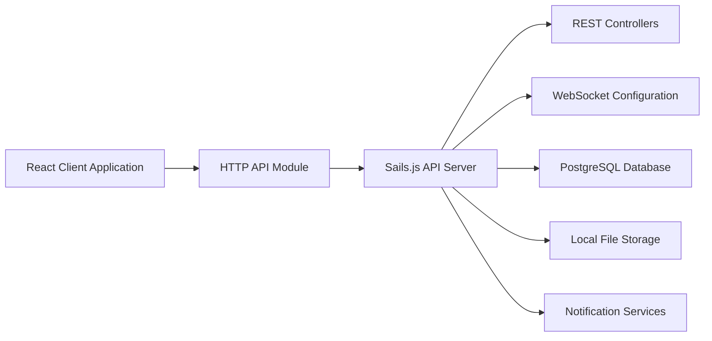

# plankanban/planka

> Self-hosted real-time collaborative kanban board, an open alternative to Trello for teams.

## The problem
SaaS kanban tools keep your data on their side; you need a self-hosted option with real time and an API.

## What it actually does
Projects, boards, lists, cards, markdown, attachments, comments, custom fields, timer.
Real-time synchronization via WebSocket, notifications through 100+ providers, webhooks, REST API, 2FA.
React/Redux client, Sails.js server, PostgreSQL, local or S3 storage.
Paid Pro version (SSO, calendar/timeline views, templates), one-way migration.

## How it is wired

## Trying it
No command in the README: it points to the external installation guide.

## Cost and gotchas
Community edition is free when self-hosted; Pro is paid, and the switch to Pro is irreversible (backup mandatory).
License present but not identified by GitHub: read it before use.

## What it is not
Not a full project management tool on the Community side: SSO, templates and multi-board cards are reserved for Pro.
No public email support.

## Alternatives
No alternative named in the README.

## For you
Ignore for a data/AI profile: it is a generic team tool, and the unidentified license needs checking before any deployment.
