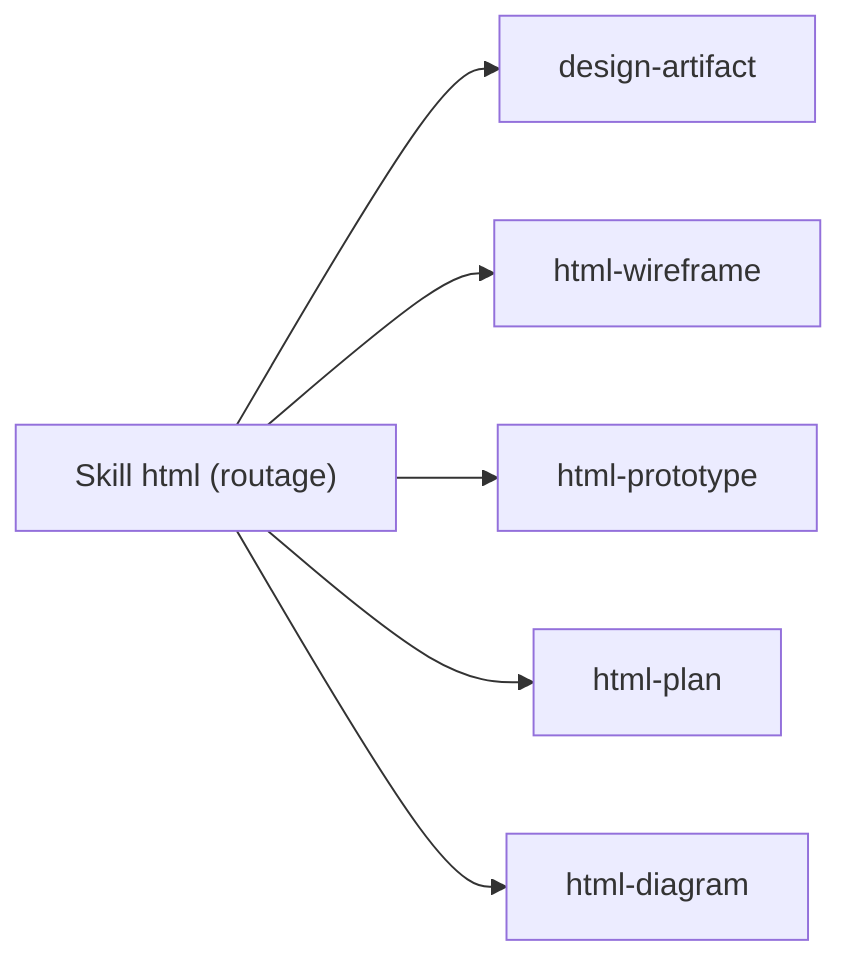

# plannotator/effective-html

> Eight agent skills for producing standalone HTML artifacts, from wireframe to interactive prototype.

## The problem
Agents answer with walls of text, whereas an HTML page often explains an idea or a plan better.

## What it actually does
Provides eight skills: `html`, `big-pics-little-words`, `one-pager`, `design-artifact`, `html-wireframe`, `html-prototype`, `html-plan`, `html-diagram`. Each frames a type of artifact (responsive, accessible, standalone, verified in a browser). Installable as skills, a Claude Code plugin or a Codex plugin.

## How it is wired
Simplified diagram based on the sheet, no diagram provided.



## Trying it
```bash
npx skills add plannotator/effective-html
npx skills add plannotator/effective-html --list
npx skills add plannotator/effective-html --skill one-pager
```

## Cost and gotchas
Free. The token consumption of the model used remains at your expense. The repository serves first as a reference; installation is optional.

## What it is not
It is not a component library nor an imposed style: these are instructions for agents. No quality measurement is provided.

## Alternatives
No alternative named in the README.

## For you
Watch: useful for visual reports or prototypes produced by an agent, but with no effect on your modeling work.
