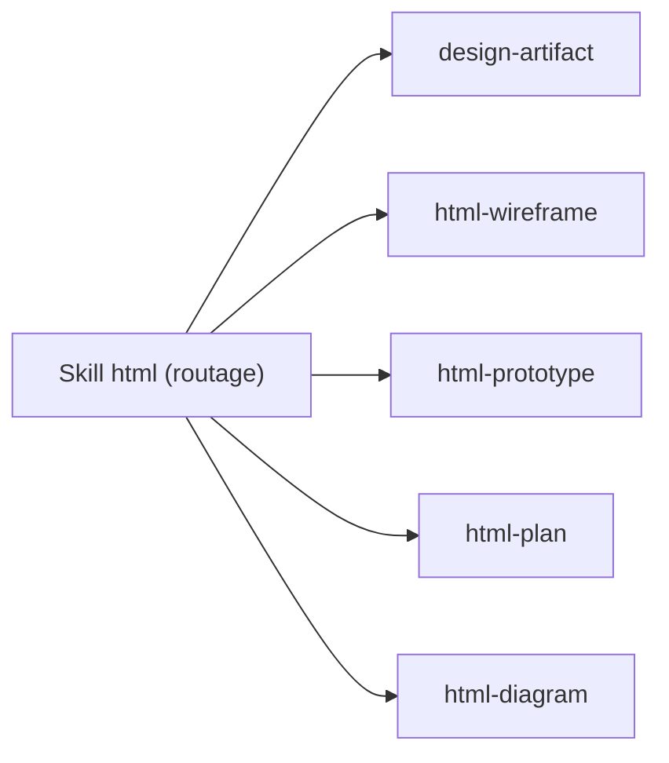

# plannotator/effective-html

> Huit skills d'agents pour produire des artefacts HTML autonomes, du wireframe au prototype interactif.

## Le problème
Les agents répondent par des murs de texte, alors qu'une page HTML explique souvent mieux une idée ou un plan.

## Ce que ça fait vraiment
Fournit huit skills : `html`, `big-pics-little-words`, `one-pager`, `design-artifact`, `html-wireframe`, `html-prototype`, `html-plan`, `html-diagram`. Chacun cadre un type d'artefact (responsive, accessible, autonome, vérifié dans un navigateur). Installable comme skills, plugin Claude Code ou plugin Codex.

## Comment c'est branché
Schéma simplifié d'après la fiche, sans diagramme fourni.



## Essayer
```bash
npx skills add plannotator/effective-html
npx skills add plannotator/effective-html --list
npx skills add plannotator/effective-html --skill one-pager
```

## Coût et pièges
Gratuit. La consommation de jetons du modèle utilisé reste à ta charge. Le dépôt sert d'abord de référence ; l'installation est facultative.

## Ce que ce n'est pas
Ce n'est pas une bibliothèque de composants ni un style imposé : ce sont des consignes pour agents. Aucune mesure de qualité n'est fournie.

## Alternatives
Aucune alternative nommée dans le README.

## Pour toi
À surveiller : utile pour des rapports ou prototypes visuels produits par un agent, mais sans effet sur ton travail de modélisation.

