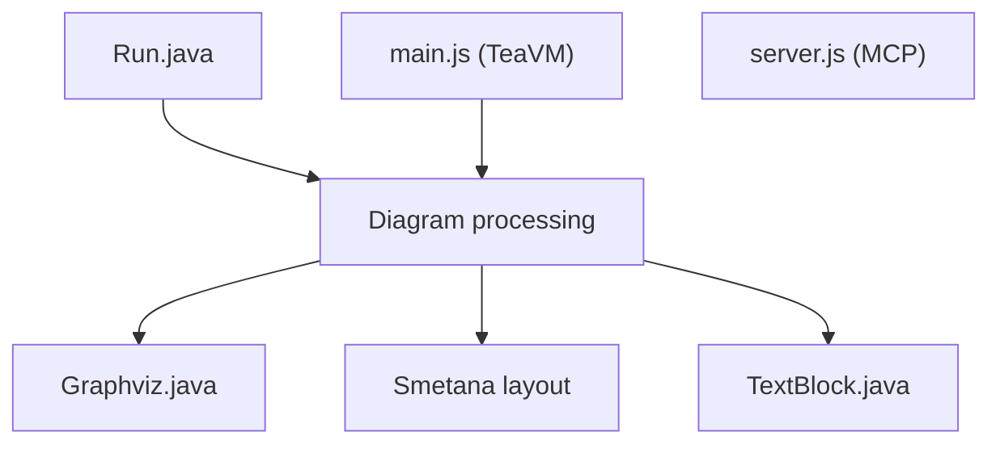

# plantuml/plantuml

> Generates UML and other diagrams from text descriptions, for developers and documentation.

## The problem
Diagrams drawn with a mouse are hard to version and drift out of sync with the code.

## What it actually does
Turns text into sequence, deployment, activity and other diagrams (EBNF and sudoku are in the code). Hyperlinks, Creole rich text, OpenIconic icons and sprites. Can be compiled to JavaScript with TeaVM for rendering entirely in the browser. A Node MCP server (`@plantuml/mcp-js`) is mentioned.

## How it is wired


## Trying it
```sh
./gradlew jar
ant
./gradlew clean teavm -Pfast
```
(build from source; the installation guide is on the official website).

## Cost and gotchas
Free. Java required; Graphviz needed for some dot-type diagrams. LGPL-3.0.

## What it is not
Not a graphical editor. No native rendering in GitHub (the browser extension is mentioned separately). This README does not detail the diagram syntax.

## Alternatives
No alternative named in the README.

## For you
Adopt it to document MLOps architectures and pipelines as versioned text; long-established, widely followed, and the MCP server serves AI assistants.
