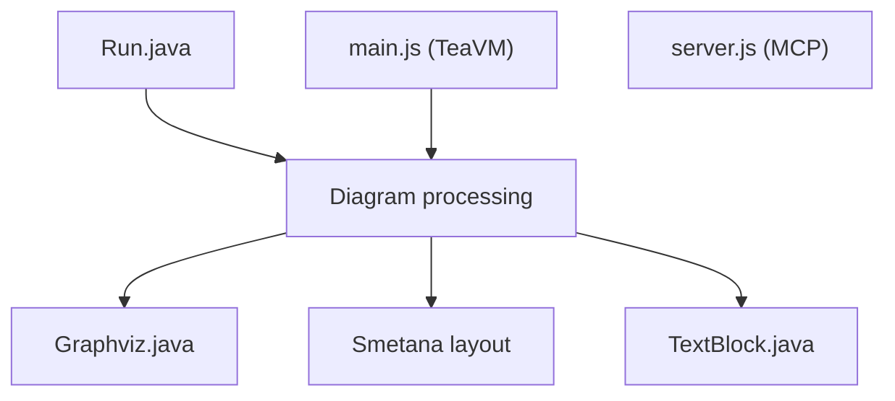

# plantuml/plantuml

> Génère des diagrammes UML et autres à partir de descriptions textuelles, pour développeurs et documentation.

## Le problème
Les diagrammes dessinés à la souris se versionnent mal et se désynchronisent du code.

## Ce que ça fait vraiment
Transforme du texte en séquence, déploiement, activité et d'autres diagrammes (EBNF, sudoku figurent dans le code). Hyperliens, texte riche Creole, icônes OpenIconic et sprites. Peut être compilé en JavaScript avec TeaVM pour un rendu entièrement côté navigateur. Un serveur MCP en Node (`@plantuml/mcp-js`) est cité.

## Comment c'est branché


## Essayer
```sh
./gradlew jar
ant
./gradlew clean teavm -Pfast
```
(construction depuis les sources ; le guide d'installation est sur le site officiel).

## Coût et pièges
Gratuit. Java requis ; Graphviz nécessaire pour certains diagrammes de type dot. LGPL-3.0.

## Ce que ce n'est pas
Pas un éditeur graphique. Pas de rendu natif dans GitHub (l'extension navigateur est citée à part). Ce README ne détaille pas la syntaxe des diagrammes.

## Alternatives
Aucune alternative nommée dans le README.

## Pour toi
À adopter pour documenter architectures et pipelines MLOps en texte versionné ; ancien, très suivi, et le serveur MCP sert aux assistants IA.

