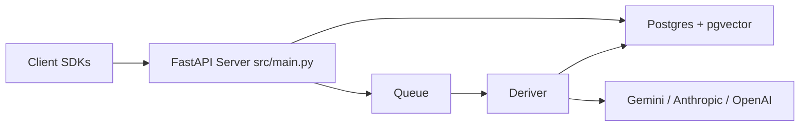

# plastic-labs/honcho

> Memory infrastructure for agents: stores exchanges and reasons about peers in the background.

## The problem
Agents forget everything between sessions, and a simple vector search does not build an understanding of the user.

## What it actually does
A workspace → peers → sessions → messages model; a "deriver" worker draws conclusions and representations asynchronously.
API: `peer.chat`, `session.context(...).to_openai()`, hybrid BM25 + vector search, low-latency representations.
FastAPI server, Postgres + pgvector, Python and TypeScript SDKs, CLI.
Plugins for Claude Code, Codex, Cursor, OpenCode, and MCP.

## How it is wired


## Trying it
```bash
pip install honcho-ai
uv tool install honcho-cli
honcho start --setup basic
```

## Cost and gotchas
Self-hosting requires three LLM keys (Gemini, Anthropic, OpenAI). The managed service is paid ($100 of credit offered).

## What it is not
Not instantaneous: the reasoning is asynchronous, and new messages take time to show up.

## Alternatives
No alternative named in the README.

## For you
Worth watching: the reasoning-based memory approach, for agents and coding agents, is relevant, but the AGPL license and the dependence on several LLMs weigh against it.
