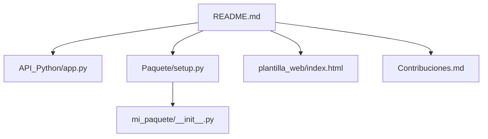

# platzi/git-github

> Exercise repository for Platzi's Git and GitHub course, with three mini-projects.

## The problem
Learning Git and GitHub requires a concrete repository to practice branches, issues and pull requests.

## What it actually does
Contains a minimal Python API (three methods), a pip package to publish, an HTML web template and a contributions file where you add your name through a pull request. Also lists Git aliases for .zshrc. The README contains leftover test text.

## How it is wired


## Trying it
```bash
pip install -r requirements.txt
uvicorn app:app --reload
python setup.py sdist bdist_wheel
```

## Cost and gotchas
Free. The associated course is in Spanish and tied to the Platzi platform; this repository alone is not enough.

## What it is not
Not a reusable project: the API and package are throwaway examples.

## Alternatives
No alternative named in the README.

## For you
Ignore: beginner course material, you already master Git; no data/AI content.
