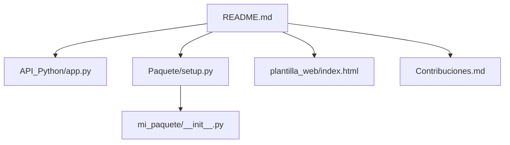

# platzi/git-github

> Dépôt d'exercice du cours Git et GitHub de Platzi, avec trois mini-projets.

## Le problème
Apprendre Git et GitHub demande un dépôt concret pour pratiquer branches, issues et pull requests.

## Ce que ça fait vraiment
Contient une API Python minimale (trois méthodes), un paquet pip à publier, une plantille web HTML et un fichier de contributions où ajouter son nom par pull request. Liste aussi des alias Git pour .zshrc. Le README contient des restes de tests.

## Comment c'est branché


## Essayer
```bash
pip install -r requirements.txt
uvicorn app:app --reload
python setup.py sdist bdist_wheel
```

## Coût et pièges
Gratuit. Le cours associé est en espagnol et lié à la plateforme Platzi, ce dépôt seul ne suffit pas.

## Ce que ce n'est pas
Pas un projet réutilisable : API et paquet sont des exemples jetables.

## Alternatives
Aucune alternative nommée dans le README.

## Pour toi
Ignorer : support de cours débutant, tu maîtrises déjà Git ; pas de contenu data/IA.

