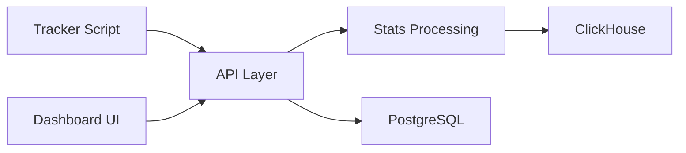

# plausible/analytics

> Cookie-free web analytics tool, a lightweight alternative to Google Analytics, in the cloud or self-hosted.

## The problem
Google Analytics collects personal data and complicates GDPR compliance.

## What it actually does
A lightweight tracking script sends events to an Elixir/Phoenix application that stores them in ClickHouse (statistics) and PostgreSQL (general data). A React dashboard shows everything on a single page, with goals, email/Slack reports, Google Analytics import and Search Console integration. The Community Edition is self-hosted but lacks the premium features.

## How it is wired

## Trying it
No command in the README: it points to the Community Edition installation documentation.

## Cost and gotchas
The cloud version is a paid subscription. The community edition is free but is released twice a year, without marketing funnels, e-commerce revenue, SSO or the sites API; you manage the server, backups and ClickHouse.

## What it is not
Not a raw-data platform in the cloud version (aggregates only). No premium support in the CE.

## Alternatives
No alternative named in the README other than Google Analytics.

## For you
Worth watching: a good choice for measuring the audience of a website or docs without cookies, but of limited use for a pure AI project.
