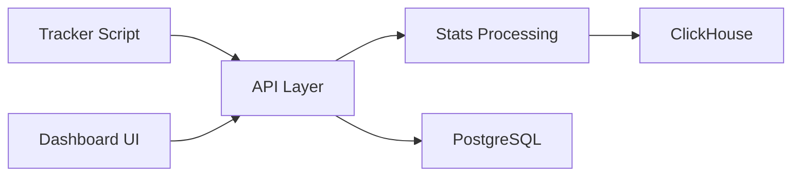

# plausible/analytics

> Outil d'analytique web sans cookies, alternative légère à Google Analytics, en cloud ou auto-hébergé.

## Le problème
Google Analytics collecte des données personnelles et complique la conformité RGPD.

## Ce que ça fait vraiment
Un script de suivi léger envoie les événements à une application Elixir/Phoenix qui les stocke dans ClickHouse (statistiques) et PostgreSQL (données générales). Un tableau de bord React affiche tout sur une page, avec objectifs, rapports par e-mail/Slack, import Google Analytics et intégration Search Console. La Community Edition est auto-hébergée mais sans les fonctions premium.

## Comment c'est branché

## Essayer
Aucune commande dans le README : renvoi à la documentation d'installation de la Community Edition.

## Coût et pièges
Cloud payant par abonnement. L'édition communautaire est gratuite mais sort deux fois par an, sans entonnoirs marketing, revenus e-commerce, SSO ni API sites ; tu gères serveur, sauvegardes et ClickHouse.

## Ce que ce n'est pas
Pas une plateforme de données brutes en version cloud (agrégats seulement). Pas de support premium en CE.

## Alternatives
Aucune alternative nommée dans le README en dehors de Google Analytics.

## Pour toi
À surveiller : bon choix pour mesurer l'audience d'un site ou d'une doc sans cookies, mais utilité limitée pour un projet IA pur.

