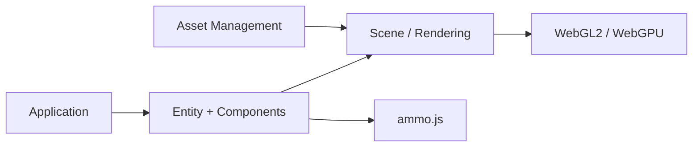

# playcanvas/engine

> Open source WebGL2/WebGPU game engine for 3D applications in the browser, aimed at web developers.

## The problem
Doing interactive 3D in a browser requires reassembling rendering, physics, sound and assets.

## What it actually does
An entity-component engine: 2D/3D graphics in WebGL2 and WebGPU, Gaussian Splatting, WebXR, physics via ammo.js, animation, input, 3D sound, glTF/Draco/Basis asset loading, TypeScript or JavaScript scripts. Ecosystem: `@playcanvas/react`, `@playcanvas/web-components`, `create-playcanvas` and an online editor.

## How it is wired


## Trying it
```bash
npm install playcanvas
npm create playcanvas@latest
npm install
npm run build
```

## Cost and gotchas
Free, Node.js 18+ to build. 491 open issues. The visual editor is a separate product.

## What it is not
Not the PlayCanvas editor: the repository only contains the engine. Not a turnkey data-viz tool.

## Alternatives
No alternative named in the README.

## For you
Worth watching: very active and solid, but your data/AI work only calls on it for 3D visualization or Gaussian Splatting in the browser.
