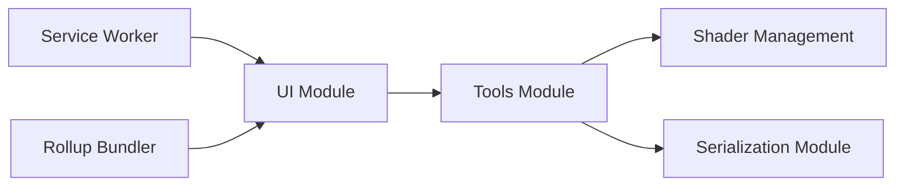

# playcanvas/supersplat

> Open-source web editor to inspect, edit and publish 3D Gaussian Splats.

## The problem
Gaussian Splatting 3D captures are raw and noisy; a tool is needed to clean and optimize them.

## What it actually does
Browser application (TypeScript, Rollup): splat selection and editing, camera tools, import/export, localization in several languages. Exposes WebMCP tools to inspect and edit the scene. An online version exists at superspl.at/editor.

## How it is wired


## Trying it
```bash
git clone https://github.com/playcanvas/supersplat.git
cd supersplat
npm install
npm run develop
```

## Cost and gotchas
Free; Node.js 20.19 or later for development. Disable the browser cache during development.

## What it is not
Not a reconstruction tool: it edits existing splats. WebMCP details are deferred to an external page.

## Alternatives
No alternative named in the README.

## For you
Worth watching: useful if you work on 3D vision or neural rendering and need to clean splats; otherwise irrelevant.
