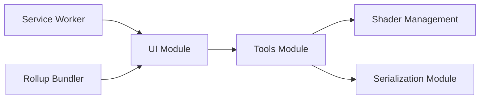

# playcanvas/supersplat

> Éditeur web open source pour inspecter, éditer et publier des Gaussian Splats 3D.

## Le problème
Les captures 3D en Gaussian Splatting sont brutes et bruitées ; il faut un outil pour les nettoyer et les optimiser.

## Ce que ça fait vraiment
Application navigateur (TypeScript, Rollup) : sélection et édition de splats, outils de caméra, import/export, localisation en plusieurs langues. Expose des outils WebMCP pour inspecter et éditer la scène. Une version en ligne existe sur superspl.at/editor.

## Comment c'est branché


## Essayer
```bash
git clone https://github.com/playcanvas/supersplat.git
cd supersplat
npm install
npm run develop
```

## Coût et pièges
Gratuit ; Node.js 20.19 ou plus pour le développement. Désactiver le cache du navigateur pendant le développement.

## Ce que ce n'est pas
Pas un outil de reconstruction : il édite des splats existants. Les détails de WebMCP sont renvoyés à une page externe.

## Alternatives
Aucune alternative nommée dans le README.

## Pour toi
À surveiller : utile si tu travailles sur la vision 3D ou le rendu neuronal et dois nettoyer des splats ; sinon sans objet.

