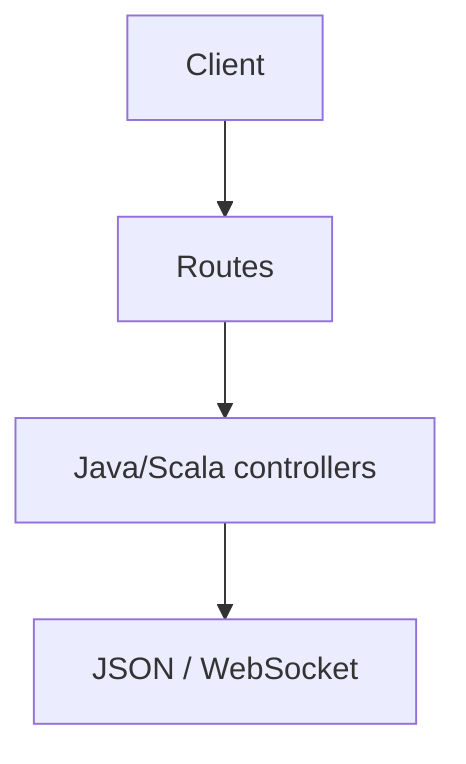

# playframework/playframework

> Stateless, non-blocking web framework for Java and Scala, for web application developers.

## The problem
Writing scalable Java/Scala web services without a heavy compile-restart cycle.

## What it actually does
The README is very short: it describes a "just hit refresh" workflow, built-in tests, REST by default, asset compilers, JSON and WebSocket. Java/Scala web framework, stateless and non-blocking architecture, REST by default, JSON and WebSocket support. Technical details point to the website and the documentation, not provided here.

## How it is wired

Generic diagram: none provided.

## Trying it
```bash
# non documenté dans le README fourni (renvoi à playframework.com)
```

## Cost and gotchas
Free. A JVM ecosystem is required (not specified in the README).

## What it is not
Not a data/AI tool. The README does not document installation.

## Alternatives
No alternative named.

## For you
Ignore: JVM web framework unrelated to data/AI/MLOps, unless you maintain Scala.
