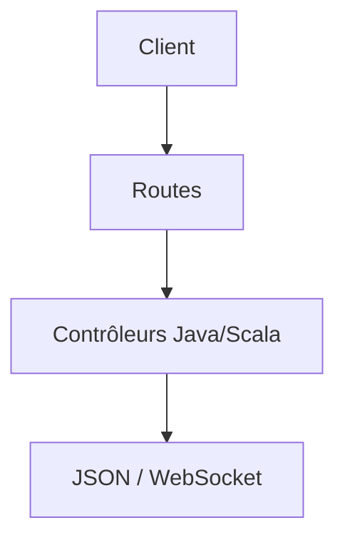

# playframework/playframework

> Framework web sans état et non bloquant pour Java et Scala, pour développeurs d'applications web.

## Le problème
Écrire des services web Java/Scala scalables sans cycle compilation-redémarrage lourd.

## Ce que ça fait vraiment
Le README est très court : il décrit un flux « just hit refresh », des tests intégrés, REST par défaut, compilateurs d'assets, JSON et WebSocket. Framework web Java/Scala, architecture stateless et non bloquante, REST par défaut, support JSON et WebSocket. Le détail technique renvoie au site et à la documentation, non fournie ici.

## Comment c'est branché

Schéma générique : aucun diagramme fourni.

## Essayer
```bash
# non documenté dans le README fourni (renvoi à playframework.com)
```

## Coût et pièges
Gratuit. Écosystème JVM requis (non précisé dans le README).

## Ce que ce n'est pas
Pas un outil data/IA. Le README ne documente pas l'installation.

## Alternatives
Aucune alternative nommée.

## Pour toi
Ignorer : framework web JVM sans lien avec data/IA/MLOps, sauf si tu maintiens du Scala.

