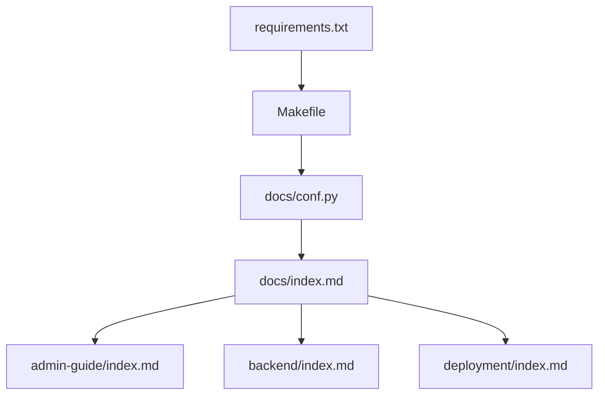

# plone/documentation

> Source of the Plone CMS documentation, for Plone administrators and developers.

## The problem
A vast CMS needs a single, versioned, published documentation.

## What it actually does
Sphinx documentation in Markdown. The `docs/index.md` index points to the administration, backend, classic interface and deployment guides; Dexterity forms a separate set. Plone 6 is on the `6.0` branch, Plone 5.2 on `5.2`. The README also mentions training materials.

## How it is wired


## Trying it
```bash
# aucune commande dans le README : la documentation est en ligne sur 6.docs.plone.org
```

## Cost and gotchas
Free. No license declared. Local build via Makefile and Sphinx, with no instructions in the README.

## What it is not
Not the Plone software itself: only its documentation.

## Alternatives
No alternative named in the README.

## For you
Ignore: documentation of a CMS you do not use for data or AI.
