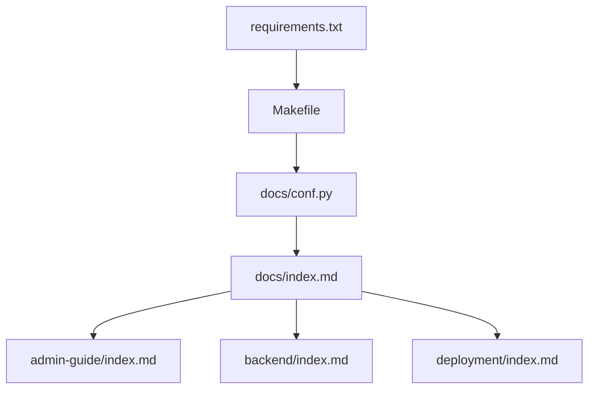

# plone/documentation

> Source de la documentation du CMS Plone, pour administrateurs et développeurs Plone.

## Le problème
Un CMS vaste a besoin d'une documentation unique, versionnée et publiée.

## Ce que ça fait vraiment
Documentation Sphinx en Markdown. L'index `docs/index.md` renvoie vers les guides d'administration, du backend, de l'interface classique et du déploiement ; Dexterity forme un ensemble à part. Plone 6 est sur la branche `6.0`, Plone 5.2 sur `5.2`. Le README mentionne aussi des supports de formation.

## Comment c'est branché


## Essayer
```bash
# aucune commande dans le README : la documentation est en ligne sur 6.docs.plone.org
```

## Coût et pièges
Gratuit. Aucune licence déclarée. Construction locale par Makefile et Sphinx, sans instructions dans le README.

## Ce que ce n'est pas
Pas le logiciel Plone lui-même : seulement sa documentation.

## Alternatives
Aucune alternative nommée dans le README.

## Pour toi
Ignorer : documentation d'un CMS que tu n'utilises pas pour la data ou l'IA.

