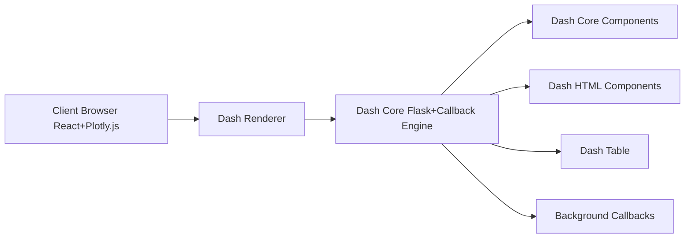

# plotly/dash

> Python framework for building interactive analytical web applications without writing JavaScript.

## The problem
Exposing an analysis or a model in an interactive interface usually means writing a React front end and an API.

## What it actually does
Declare the layout in Python (core components, HTML, table), rendered by React and Plotly.js.
Reactive Python callbacks linking inputs and outputs, served by Flask.
Background callbacks via Celery or DiskCache for long computations.
~50 chart types; Dash Enterprise (paid) adds deployment, auth, job queue.

## How it is wired

## Trying it
No installation command documented in the README (it points to the tutorial).

## Cost and gotchas
Free in open source (MIT). Sharing, auth and scalability fall under Dash Enterprise, which is paid.

## What it is not
Not a hosting solution: the OSS version runs locally. The README is largely promotional for the Enterprise offer.

## Alternatives
No alternative named in the README.

## For you
Adopt: a safe tool for turning a notebook into an interactive Python dashboard, provided you handle deployment and authentication yourself.
