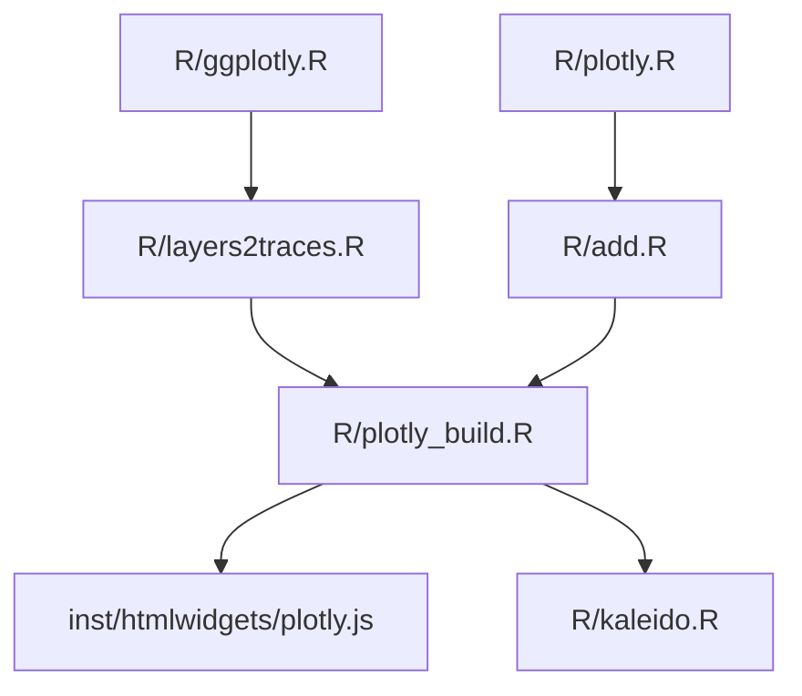

# plotly/plotly.R

> R package to create interactive charts via plotly.js, from ggplot2 or directly.

## The problem
Static R charts allow neither hovering, zooming, nor web integration.

## What it actually does
`ggplotly()` converts a ggplot2 chart into an interactive version; `plot_ly()` gives direct access to plotly.js (surfaces, meshes, parallel coordinates). Integrates with Shiny and R Markdown, and exports images via kaleido.

## How it is wired


## Trying it
```r
install.packages("plotly")
library(plotly)
ggplotly(g)
plot_ly(z = ~volcano, type = "surface")
```

## Cost and gotchas
Free. Requires R. `ggplotly()` fidelity is partial: the README admits that you sometimes need to adjust via `style()` and `layout()`. Last push in July 2026.

## What it is not
Not the Python version of plotly. Not a paid service: the package works locally.

## Alternatives
No alternative named in the README.

## For you
Keep an eye on it: useful if you work in R, otherwise plotly for Python already covers this need.
