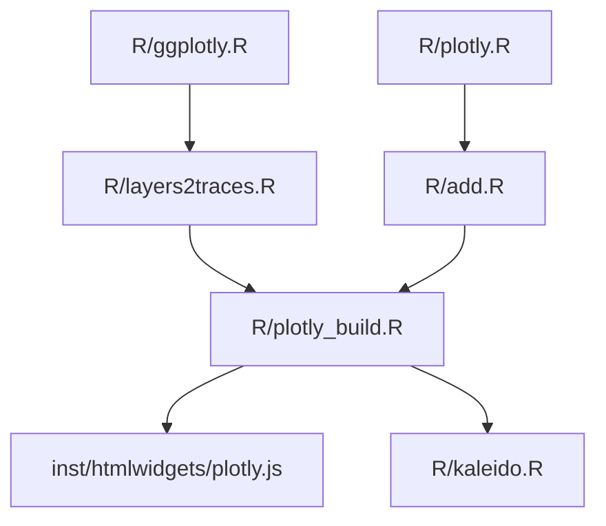

# plotly/plotly.R

> Paquet R pour créer des graphiques interactifs via plotly.js, à partir de ggplot2 ou en direct.

## Le problème
Les graphiques R statiques ne permettent ni survol, ni zoom, ni intégration web.

## Ce que ça fait vraiment
`ggplotly()` convertit un graphique ggplot2 en version interactive ; `plot_ly()` donne un accès direct à plotly.js (surfaces, maillages, coordonnées parallèles). S'intègre à Shiny, R Markdown, et exporte des images via kaleido.

## Comment c'est branché


## Essayer
```r
install.packages("plotly")
library(plotly)
ggplotly(g)
plot_ly(z = ~volcano, type = "surface")
```

## Coût et pièges
Gratuit. Nécessite R. Fidélité de `ggplotly()` partielle : le README admet qu'il faut parfois ajuster via `style()` et `layout()`. Dernier push en juillet 2026.

## Ce que ce n'est pas
Pas la version Python de plotly. Pas un service payant : le paquet fonctionne localement.

## Alternatives
Aucune alternative nommée dans le README.

## Pour toi
Surveiller : utile si tu travailles en R, sinon plotly pour Python couvre déjà ce besoin.

