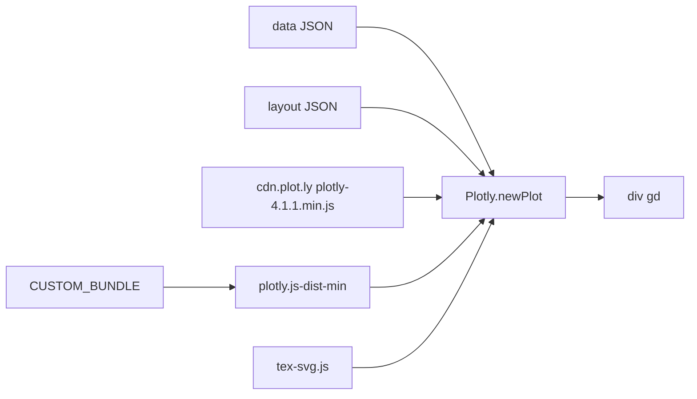

# plotly/plotly.js

> Interactive JavaScript visualization library, the engine behind the `plotly` Python and R packages.

## The problem
An interactive chart in a browser takes either a lot of hand-written D3 or a closed component.
And going from a Python prototype to web rendering often breaks the chart along the way.

## What it actually does
Dozens of chart types: statistical, 3D, scientific, SVG and tile maps, finance.
A chart is described in JSON (`data`, `layout`) and rendered with `Plotly.newPlot("gd", ...)`.
Renders math formulas between `$..$` if MathJax v3 or v4 is loaded separately on the page.
Two families of bundles: official full or partial ones on npm and CDN, or custom bundles.

## How it is wired


## Trying it
```bash
npm i --save plotly.js-dist-min
```
Or via a script tag: `<script src="https://cdn.plot.ly/plotly-4.1.1.min.js" charset="utf-8"></script>`,
then `Plotly.newPlot("gd", [{ y: [1, 2, 3] }])`.

## Cost and gotchas
Since v2, `plotly-latest.min.js` is no longer updated and stays frozen at v1.58.5: you must pin
an exact version on the CDN. Several WebGL charts on one page require the `virtual-webgl` script.

## What it is not
Not a lightweight package by default: the full bundle is heavy, hence the partial and custom bundles.
Not the documentation: it lives in another repository, `graphing-library-docs`.
Not independent of MathJax for formulas: MathJax is not included.

## Alternatives
`plotly.js-dist` — the same thing unminified, if you prefer to read the shipped code.

## For you
The foundation behind Plotly.py: knowing the bundles keeps you from shipping 3 MB of JS for a histogram.
